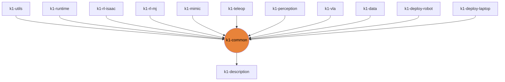

# k1-common

Robot contract: joints, gains, obs/action layout, wiring, motion-clip schema.

| | |
|---|---|
| Layer | **L0**: Contract (no heavy deps) |
| May import | [k1-description](https://github.com/thdhyan/k1-description) |
| Files / LOC | 11 files · 585 lines (py, sh, cpp) |
| Part of | [k1-workspace](https://github.com/thdhyan/k1-workspace) (architecture and layering rules live there) |

## Where it sits



Used by: k1-utils, k1-runtime, k1-rl-isaac, k1-rl-mj, k1-mimic, k1-teleop, k1-perception, k1-vla, k1-data, k1-deploy-robot, k1-deploy-laptop.


## Install

```bash
uv add git+https://github.com/thdhyan/k1-common
# or, from a checkout
uv sync
```

## Usage

The robot contract other libraries import. It has no heavy dependencies.

```python
from k1_common.paths import models_dir, model   # $K1_MODELS_DIR, default ~/k1_models
ckpt = model("mjlab_k1/walk_still_v2/model_8998.pt")
from k1_common import clip_schema                 # motion-clip schema shared with k1-mimic
```
`ros/k1_interfaces` is the ROS 2 message package. Build it with colcon from k1-deploy-laptop's workspace.

## Tests

From a k1-workspace checkout (see its README, "Run the tests"):
```bash
cd libs/k1-common && python -m pytest -q tests
```

## Robots and hosts

Robot IPs, SSH aliases, network, safety and how to control each robot: [docs/ROBOTS.md](https://github.com/thdhyan/k1-workspace/blob/main/docs/ROBOTS.md) in k1-workspace.

## Environment variables read

`K1_JOINT_NAMES`, `K1_MODELS_DIR`

## Layout

```
README.md
pyproject.toml
ros/  (8 files)
  k1_interfaces/  (8 files)
src/  (7 files)
  k1_common/  (7 files)
tests/  (2 files)
  test_k1_wiring.py
```

## Dependencies

- Declared sibling libraries: k1-description (see `pyproject.toml`, `[tool.uv.sources]`).
- PyPI: mujoco, numpy, pytest.
- Provided by the environment (ROS 2, Isaac, mjlab, robot SDK) or unresolved: `pxr`.

## Hard-coded paths into other repos

These files still name paths that now live in another repo (hard-coded path strings, not imports). Pass them as arguments / config when you touch the file:

| File | Refers to | Owner |
|---|---|---|
| `README.md` | `mjlab_k1/` | k1-rl-mj |
| `src/k1_common/k1_wiring.py` | `real_robot/` | k1-data |

## Origin

Extracted from `booster_ws` (branch `dev/push-training-wip`, working tree of 2026-11-03) by
`tools/build_workspace.py` in k1-workspace. Old path to new path for every file: [`docs/migration_map.tsv`](https://github.com/thdhyan/k1-workspace/blob/main/docs/migration_map.tsv) (filter on `k1-common`).
History was not carried over: the working tree was copied as is, including previously untracked files.
